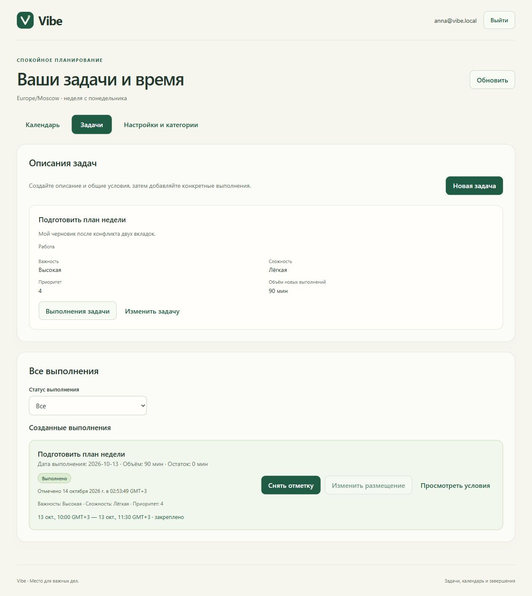

# Vibe

Персональный планировщик на ASP.NET Core/.NET 10, PostgreSQL/EF Core и React/TypeScript/Vite. Реализованы вход, отдельные задачи/выполнения, ручной календарь день/неделя, обратимые отметки завершения, синхронизация Web-клиентов и черновики. U1 добавляет единую форму, необязательные дату/часы/объём, повторение по дням недели либо через каждые N дней и общие часы серии с безопасным размещением. Список задач имеет периоды и порядок от сегодняшнего дня, календарь использует доступное окно. Фактические проверки и границы — в [U1_STATUS.md](docs/U1_STATUS.md); история — в [R1_STATUS.md](docs/R1_STATUS.md), [S1_STATUS.md](docs/S1_STATUS.md), [C1_STATUS.md](docs/C1_STATUS.md) и [D1_STATUS.md](docs/D1_STATUS.md).

Публичный репозиторий: [Sluchaino/Vibe](https://github.com/Sluchaino/Vibe).



## Подготовка

На этой машине .NET SDK 10.0.400 и Docker Desktop уже установлены; Node 24.19.0 и pnpm 11.25.0 доступны через runtime Codex. Скрипты находят Node/pnpm и в обычном PowerShell. Android Studio/Kotlin сейчас не требуются.

Из корня проекта:

~~~powershell
powershell -NoProfile -ExecutionPolicy Bypass -File .\scripts\prepare-local.ps1
docker compose up -d --wait
powershell -NoProfile -ExecutionPolicy Bypass -File .\scripts\dev.ps1 web -WebCommand install
~~~

Docker Desktop должен работать. Подготовка создаёт локальные секреты и два аккаунта в `.tools/local-development.json`, сохраняя существующие пароли. Начальная PostgreSQL содержит отдельную БД `vibe_d1_tests`; тесты используют только её и свои временные схемы. Не удаляйте Docker volume для повторного запуска.

Разовое доверие сертификату на этой машине добавлено 12.10.2026 по отдельному разрешению владельца. На другом компьютере после подготовки выполните `dotnet dev-certs https --trust` самостоятельно и подтвердите Windows-диалог. Подготовительный скрипт доверие автоматически не добавляет.

## Запуск

Для обычного запуска на уже подготовленной машине сначала откройте Docker Desktop и дождитесь его готовности. В первом PowerShell-окне перейдите в проект и запустите БД и Backend:

```powershell
Set-Location C:\MyApps\MyProjects\Vibe
docker compose up -d --wait db
powershell -NoProfile -ExecutionPolicy Bypass -File .\scripts\dev.ps1 backend
```

Откройте второе PowerShell-окно и запустите Web:

```powershell
Set-Location C:\MyApps\MyProjects\Vibe
powershell -NoProfile -ExecutionPolicy Bypass -File .\scripts\dev.ps1 web
```

Оставьте оба окна открытыми и откройте в обычном браузере <https://localhost:5173/>. Backend: <https://localhost:5443/health>. Оба компонента слушают loopback. Остановить процесс: `Ctrl+C` в его терминале. Если порт уже занят работающим Vibe, откройте указанный адрес либо сначала остановите старый экземпляр. Backend в Development применяет миграции через явный флаг скрипта; данные сохраняются в Docker volume. Повторять первоначальную подготовку и установку зависимостей при каждом запуске не нужно.

С 19.10 PostgreSQL доступен локально на порту **15432**: прежние 54329 и 55432 попадали в динамический резерв Windows после перезагрузки. Для существующей настройки замените только старый `Port=54329` или `Port=55432` на `Port=15432` в обеих строках `ConnectionStrings.Vibe` и `ConnectionStrings.VibeTests` файла `.tools/local-development.json`; остальные значения, пароли и volume сохраняйте. Затем выполните `docker compose up -d --wait db`. В текущем рабочем каталоге это обновление уже выполнено. Новая подготовка создаёт конфигурацию с правильным портом.

Имена пользователей и пароли смотрите в локальном `.tools/local-development.json`, разделе `LocalDevelopment.SeedUsers`. Они не публикуются в исходниках. После входа задайте место. Новая задача доступна из календаря и списка задач. В единой форме обязательно только название; описание, дата, часы и полный объём необязательны. Интервал09:00–11:00 вычисляет120 минут; введённый вручную объём сохраняется и проверяется. Кнопка «Создать задачу» последовательно сохраняет данные с подтверждением каждого шага. При обрыве связи продолжение доступно в «Сохранённое в браузере» с прежними идентификаторами. Неопределённые часы при переводе времени требуют явного выбора. Закреплённое время переносится только после отдельного подтверждения.

Карточка «Без времени» не занимает часы в календаре. При заданной дате она видна в соответствующем дне; без даты — в списке задач с периодом «Все» или «Без даты». Полный разрешимый интервал при создании размещается автоматически. Если время занято, выполнение сохраняется с объяснением и без сдвига других блоков. Для дальнейшего ручного размещения нужны дата и известный полный объём.

«Ограничить допустимое время» — необязательная настройка, например по будням с 09:00 до 18:00. Без интервалов и исключений подходит любое время. Сворачивание раздела не удаляет заданные ограничения. Часовой пояс выбирается в настройках; в обычных карточках показываются дата и часы без GMT.

Основная форма содержит название, дату, одно клавиатурное поле времени (`10:00 - 11:30`) и полный объём. Кнопка «Расширенные настройки» открывает отдельные разделы описания/характеристик, повторения, часового пояса/фиксации и допустимых интервалов. Возврат сохраняет ввод; создание выполняется кнопкой «Создать задачу». Незавершённая строка времени сохраняется в черновике и после перезагрузки, но перед созданием её нужно исправить. Повторные расчёты календаря при печати оптимизированы без изменения аварийного сохранения. Проверки — в [WEB_TASK_EDITOR_STATUS.md](docs/WEB_TASK_EDITOR_STATUS.md); предыдущая версия формы — в [WEB_DATE_TIME_STATUS.md](docs/WEB_DATE_TIME_STATUS.md).

Разделения формы на одноразовую и повторяющуюся больше нет. В поле «Повторение» доступны каждый день, будни, выходные, выбранные дни и каждые N дней. Дата окончания серии необязательна и включается в неё. Для режима N сохраняется постоянная опорная дата. Сервер готовит отдельные выполнения на31 день вперёд и продлевает горизонт; выбранные часы применяются ко всей серии, с отдельной проверкой занятости на каждой дате. Кнопка «Повторение» в общих условиях останавливает создание новых выполнений; уже созданные, их блоки и отметки сохраняются. Дробление будет отдельным этапом. Подробности U1 и фактические проверки — в [U1_STATUS.md](docs/U1_STATUS.md).

Изменения из другого клиента поступают автоматически: видимая вкладка опрашивает сервер примерно раз в 5 секунд, а также при возвращении к ней и восстановлении сети. Ввод в открытой форме сохраняется отдельно от свежих серверных данных. При конфликте нужно сравнить редакции и явно выбрать новую основу для отправки. После совместного обновления Backend/Web до U1 перезагрузите прежние вкладки: синхронизация теперь использует s3, старые временные серверные снимки сбрасываются при миграции, пользовательские данные и локальные черновики сохраняются.

При частых перезагрузках после изменений возможно временное `syncBootstrapBusy`: на аккаунт допускаются четыре активных снимка начальной загрузки, каждый живёт до 15 минут. Повторите «Обновить» позже, когда сервер освободит снимок; данные браузера очищать не нужно. Действующие клиенты с полученным состоянием продолжают читать изменения. Этот предел защищает ресурсы и не является потерей задач.

Черновики и одна неподтверждённая отправка на аккаунт сохраняются в IndexedDB браузера. Черновик открывается кнопкой «Редактировать»; простое открытие не создаёт копии. Кнопка «Сохранить черновик» обновляет ту же запись. При уходе из изменённой формы появляется вопрос «Сохранить черновик?» с выбором сохранить, не сохранять текущие изменения или продолжить редактирование. При конфликте двух вкладок сохранение приостанавливается, введённый текст остаётся доступен. Перезагрузка/закрытие браузера использует штатное предупреждение браузера; его текст задаёт браузер.

Аварийное восстановление ввода и техническое продолжение создания отображаются отдельно от сохранённых вручную черновиков. После перезагрузки войдите в тот же аккаунт и откройте «Сохранённое в браузере». Повтор отправки использует первоначальную операцию, а более новый ввод хранится отдельно. Разные адреса Web имеют разные локальные хранилища. Очистка данных браузера удаляет эти локальные записи; пароли и cookie в IndexedDB не сохраняются. Если локальное хранилище недоступно, просмотр работает, но новая отправка блокируется. Полноценный запуск и редактирование без сети в S1 не входят.

Завершение: во вкладке «Задачи» у конкретного выполнения нажмите «Отметить выполненным» и подтвердите действие в открывшейся карточке. Можно также открыть блок в календаре. После отметки доступна кнопка «Снять отметку»; её снятие возвращает полный остаток и редактирование условий/размещения. Другие выполнения задачи сохраняют свой статус. Сам календарный блок остаётся занятым с прежней длительностью. Статусы: все, не выполненные, выполненные. Период по умолчанию — сегодня; доступны неделя, месяц, все и собственные включительные даты. В текущей неделе и месяце сначала идут сегодня и ближайшие дни, затем «Прошедшие дни» того же периода.

Первичная подготовка зависимостей Web или восстановление после удаления node_modules:

```powershell
powershell -NoProfile -ExecutionPolicy Bypass -File .\scripts\dev.ps1 web -WebCommand install
```

В текущем Codex Node/pnpm доступны из bundled runtime. `scripts/dev.ps1` умеет найти эти пути и из обычного терминала. На другом компьютере установить подходящие Node/pnpm и .NET SDK; проверить команды через [check_dev_environment.ps1](scripts/check_dev_environment.ps1). Скрипт проверки не заменяет сборку.

## Проверки

```powershell
powershell -NoProfile -ExecutionPolicy Bypass -File .\scripts\check_dev_environment.ps1 -RequireDatabase
powershell -NoProfile -ExecutionPolicy Bypass -File .\scripts\test-backend.ps1
powershell -NoProfile -ExecutionPolicy Bypass -File .\scripts\dev.ps1 web -WebCommand test
powershell -NoProfile -ExecutionPolicy Bypass -File .\scripts\dev.ps1 web -WebCommand build
```

Для локального production preview: `powershell -NoProfile -ExecutionPolicy Bypass -File .\scripts\dev.ps1 web -WebCommand preview`, адрес <https://localhost:4173/>; Backend должен работать. Dev/preview передают `/api` и `/health` через HTTPS proxy с проверкой конкретного локального сертификата. Health проверяет процесс; готовность PostgreSQL проверяется отдельно.

В Windows sandbox команды могут не иметь доступа к NuGet.Config, registry или localhost. Разрешённый запуск снаружи sandbox нужен для таких операций; это не ошибка кода и не повод расширять права reviewer. Глобальные настройки Codex не меняются.

## Разработка

Утверждены [T0, D1, C1, S1, R1 и U1](docs/DECISIONS.md); остальные ADR остаются предложениями. Общий контракт — [contracts/d1.openapi.json](contracts/d1.openapi.json). Рабочие роли — [AGENT_USAGE.md](docs/AGENT_USAGE.md) и [AGENTS.md](AGENTS.md); требования и план — [docs/README.md](docs/README.md). Android, дробление, полная работа без сети, таймер и автопланирование остаются последующими этапами. C1 и S1 ранее опубликованы в GitHub; сохранение завершённых R1/U1 и правок Web разрешено владельцем30.10.2026 по GH-04. История проверок — в статусах соответствующих срезов. Local config/пароли, сертификаты, БД и кэши в репозиторий не входят; на другой машине подготовка создаёт собственные секреты.
