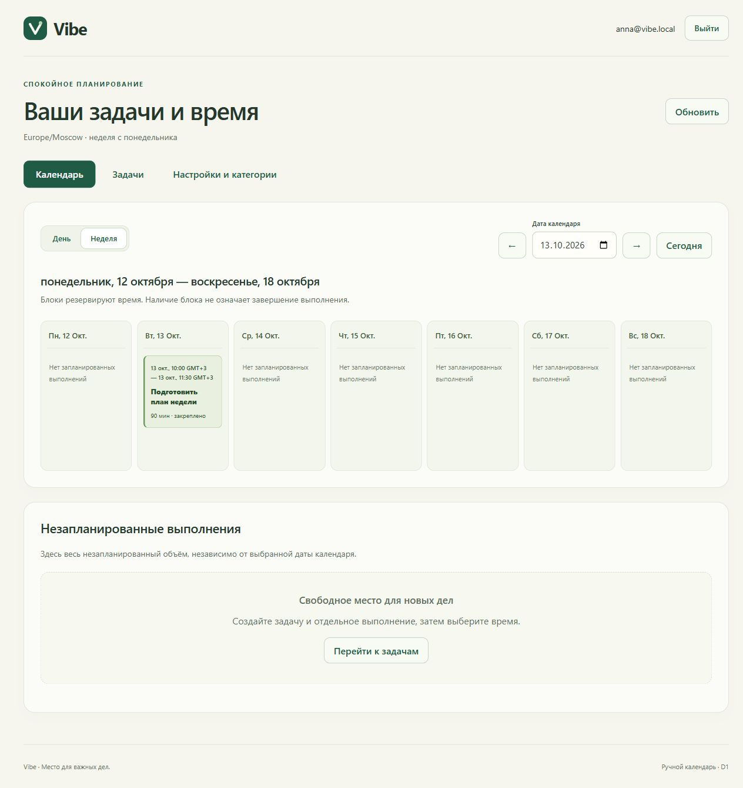

# Vibe

Персональный планировщик на ASP.NET Core/.NET 10, PostgreSQL/EF Core и React/TypeScript/Vite. Утверждённый D1 включает вход, задачи, отдельные выполнения и ручной календарь день/неделя. Фактические проверки и ограничения — в [D1_STATUS.md](docs/D1_STATUS.md).

Публичный репозиторий: [Sluchaino/Vibe](https://github.com/Sluchaino/Vibe).



## Подготовка

На этой машине .NET SDK 10.0.400 и Docker Desktop уже установлены; Node 24.19.0 и pnpm 11.25.0 доступны через runtime Codex. Скрипты находят Node/pnpm и в обычном PowerShell. Android Studio/Kotlin сейчас не требуются.

Из корня проекта:

~~~powershell
powershell -NoProfile -ExecutionPolicy Bypass -File .\scripts\prepare-local.ps1
docker compose up -d --wait
powershell -NoProfile -ExecutionPolicy Bypass -File .\scripts\dev.ps1 web -WebCommand install
~~~

Docker Desktop должен работать. Подготовка создаёт локальные секреты и два аккаунта в `.tools/local-development.json`, сохраняя существующие пароли. Начальная PostgreSQL содержит отдельную БД `vibe_d1_tests`; тесты используют только её и свои временные схемы. Не удаляйте Docker volume для повторного запуска.

Разовое доверие сертификату на этой машине добавлено 12.10.2026 по отдельному разрешению владельца. На другом компьютере после подготовки выполните `dotnet dev-certs https --trust` самостоятельно и подтвердите Windows-диалог. Подготовительный скрипт доверие автоматически не добавляет.

## Запуск

Из корневой папки проекта в двух отдельных PowerShell-терминалах:

```powershell
powershell -NoProfile -ExecutionPolicy Bypass -File .\scripts\dev.ps1 backend
```

```powershell
powershell -NoProfile -ExecutionPolicy Bypass -File .\scripts\dev.ps1 web
```

Открыть Web: <https://localhost:5173/>. Backend: <https://localhost:5443/health>. Оба компонента слушают loopback. Остановить процесс: `Ctrl+C` в его терминале. Backend в Development применяет миграции через явный флаг скрипта; данные сохраняются в Docker volume.

Имена пользователей и пароли смотрите в локальном `.tools/local-development.json`, разделе `LocalDevelopment.SeedUsers`. Они не публикуются в исходниках. В интерфейсе: войти → задать место → создать категорию/задачу → открыть «Выполнения задачи» → создать выполнение → «В календарь» → выбрать дату, время и смещение UTC. Закреплённое время переносится только после отдельного подтверждения.

Черновики и неподтверждённые операции разделены по аккаунтам и сохраняются в памяти вкладки. Перезагрузка/закрытие вкладки сохраняет серверные данные, но не несохранённый ввод. Web не является офлайн-клиентом.

Первичная подготовка зависимостей Web или восстановление после удаления node_modules:

```powershell
powershell -NoProfile -ExecutionPolicy Bypass -File .\scripts\dev.ps1 web -WebCommand install
```

В текущем Codex Node/pnpm доступны из bundled runtime. `scripts/dev.ps1` умеет найти эти пути и из обычного терминала. На другом компьютере установить подходящие Node/pnpm и .NET SDK; проверить команды через [check_dev_environment.ps1](scripts/check_dev_environment.ps1). Скрипт проверки не заменяет сборку.

## Проверки

```powershell
powershell -NoProfile -ExecutionPolicy Bypass -File .\scripts\check_dev_environment.ps1 -RequireDatabase
powershell -NoProfile -ExecutionPolicy Bypass -File .\scripts\test-backend.ps1
powershell -NoProfile -ExecutionPolicy Bypass -File .\scripts\dev.ps1 web -WebCommand test
powershell -NoProfile -ExecutionPolicy Bypass -File .\scripts\dev.ps1 web -WebCommand build
```

Для локального production preview: `powershell -NoProfile -ExecutionPolicy Bypass -File .\scripts\dev.ps1 web -WebCommand preview`, адрес <https://localhost:4173/>; Backend должен работать. Dev/preview передают `/api` и `/health` через HTTPS proxy с проверкой конкретного локального сертификата. Health проверяет процесс; готовность PostgreSQL проверяется отдельно.

В Windows sandbox команды могут не иметь доступа к NuGet.Config, registry или localhost. Разрешённый запуск снаружи sandbox нужен для таких операций; это не ошибка кода и не повод расширять права reviewer. Глобальные настройки Codex не меняются.

## Разработка

Утверждены [T0 и D1](docs/DECISIONS.md); остальные ADR остаются предложениями. Общий контракт — [contracts/d1.openapi.json](contracts/d1.openapi.json). Рабочие роли — [AGENT_USAGE.md](docs/AGENT_USAGE.md) и [AGENTS.md](AGENTS.md); требования и план — [docs/README.md](docs/README.md). Android, синхронизация, таймер и автопланирование остаются последующими этапами. Публикация текущего D1 в GitHub отдельно поручена владельцем 13.10.2026 (GH-01). Local config/пароли, сертификаты, БД и кэши в репозиторий не входят; на другой машине подготовка создаёт собственные секреты.
