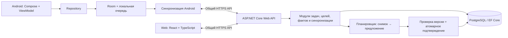

# Vibe — предложение архитектуры

Статус: DRAFT / PROPOSED. Основные технологии заданы владельцем. Узкий каркас T0 (`backend/Vibe.Api` на .NET 10 и `web/` на React/TypeScript/Vite, health/UI) отдельно утверждён и создан. Предметные модули, модель/API, auth и развёртывание остаются предложениями до выбора по DECISIONS.md; T0 не утверждает схему ниже целиком.

## Общая схема

## Backend

PROPOSED ADR-01: модульный монолит в одном ASP.NET Core приложении и одной PostgreSQL базе. Модули: Tasks, Recurrence/Goals, Places, Execution/Statistics, Planning, Sync и Identity. Внутри — Domain (инварианты), Application (сценарии), Infrastructure (EF Core/solver/хранение), API (контракты/авторизация). Это логические границы; число C# проектов определить перед каркасом без избыточных слоёв.

Planning получает неизменяемый снимок входных данных и возвращает предложение, незапланированные остатки и причины. Не записывает принятое расписание напрямую. Application подтверждает предложение транзакционно при совпадении версий. Дорогой расчёт выполняется вне длительной БД-транзакции.

PROPOSED уточнение согласованности: задачи, факты, граф и обе revision читать из одного согласованного PostgreSQL snapshot в короткой read-транзакции (кандидат — repeatable read), затем закрывать её до расчёта. Каждая запись входов и bump planningInputRevision выполняются атомарно. Подтверждение и изменяющие входы транзакции используют общий конкурентный guard состояния пользователя, чтобы сравнение версии и запись плана не разделялись гонкой. Простое чтение «последней revision» после независимых запросов не даёт согласованного снимка.

PROPOSED ADR-04: адаптер к готовому OR-Tools CP-SAT с ограниченным горизонтом, целыми единицами времени и временем решения. Нужен технический spike совместимости C#/native runtime и тестов доменных ограничений. OR-Tools содержит задачи расписаний и C# примеры CP-SAT; это обоснование кандидата, а не доказательство пригодности конкретной модели Vibe. [Scheduling](https://developers.google.com/optimization/scheduling), [CP-SAT](https://developers.google.com/optimization/cp/cp_solver).

Для первого простого среза возможен стандартный greedy list scheduling за тем же интерфейсом, если владелец одобрит ограниченный набор ограничений. Не вводить скрытый fallback, который нарушает дорогу, фиксацию или объём. Solver-status UNKNOWN не означает INFEASIBLE.

Сервер проверяет все предметные инварианты, пользователя, версии и разрешения независимо от клиента. EF Core optimistic concurrency — механизм конкурентного обновления; выбор токена и протокола синхронизации остаётся нашим проектным решением. [Документация EF Core](https://learn.microsoft.com/en-us/ef/core/saving/concurrency).

## Android

PROPOSED ADR-03: Compose → ViewModel → Repository → Room; локальная БД является источником состояния UI, сетевые результаты поступают в неё. Запись сущности и outbox в одной Room-транзакции. Синхронизатор отправляет/получает изменения через общий API; WorkManager — кандидат для повторов при доступной сети. Паттерн локального источника и очередей описан в [Android offline-first](https://developer.android.com/topic/architecture/data-layer/offline-first); точная реализация предложена в SYNC_DESIGN.md.

Таймер хранит состояние, интервалы работы и события отдельно от календаря. В активном процессе измеряет прошедшее время монотонными часами; восстановление после перезапуска использует сохранённые опорные значения с явной обработкой reboot/смены часов. Уведомления, фоновые ограничения и точность alarm уточняются после выбора Android API. Таймер не зависит от сети и не использует фоновый sync-worker как секундомер.

Android может выполнять локальную валидацию для удобства; авторитетные серверные правила сохраняются. Автоматического локального планировщика в исходной архитектуре нет.

## Web

PROPOSED: React SPA, TypeScript, общий контракт API. Экраны: календарь день/неделя/месяц, задачи и шаблоны, места/связи, цели, preview планирования, таймер/факты при одобрении Web-таймера, статистика. Обязательный офлайн-таймер относится к Android; Web-таймер — уточнение, не автоматически добавленная функция.

Библиотеку календаря, формы и query-cache выбрать отдельным решением с учётом лицензии, доступности и календарных timezone. Offline-first Web, отдельный BFF, SSR, realtime WebSocket и внешняя аналитика сейчас не требуются. UI отражает конфликты и версии, не подменяет серверную бизнес-логику.

## Общий API и контракты

PROPOSED ADR-05: версионированный REST/JSON и OpenAPI; общий контракт фиксируется до реализации клиентов. Обсуждаемые ресурсы: определения задач, конкретные выполнения, календарь, правила повторений, цели, шаблоны, места/рёбра, рабочие сессии/завершения, операции sync, запросы/предложения/подтверждения плана.

Это перечень, а не утверждённые URL/DTO. Согласовать enum/nullable, формат длительностей/времени, optimistic concurrency, идемпотентность, пагинацию, ошибки конфликта и авторизацию. Серверные идентификаторы и клиентские UUID должны поддерживать создание офлайн. Генерируемые клиентские типы возможны после выбора генератора.

API-версия, версия каждой сущности, sync-cursor, planning-input revision и accepted-schedule version имеют разные цели. Их нельзя подменять одним timestamp.

## Предложенная структура репозитория

| Путь | Содержимое после утверждения |
| --- | --- |
| `backend/` | Серверные исходники и тесты |
| `android/` | Android-проект и тесты |
| `web/` | React/TypeScript и тесты |
| `contracts/` | Утверждённые спецификации API и проверки совместимости |
| `docs/` | Требования, решения и процедуры |
| `.codex/` | Проектные настройки и пять ролей |
| `scripts/` | Проверки инфраструктуры разработки |

## Технические ограничения и риски

- Монолит упрощает транзакционную согласованность; очень дорогой solver позднее можно вынести через интерфейс без изменения предметного протокола подтверждения.
- Сеть ненадёжна: повтор доставки обязателен, порядок/конфликты определяются серверными версиями. Расписания могут устареть между расчётом и подтверждением.
- PostgreSQL и Room не делят физическую схему. Контракт — предметные данные; EF-модели не отправляются клиентам напрямую.
- Даты повторений и абсолютные интервалы имеют разные семантики; DST проверяется отдельными тестами.
- Серверная очередь фоновых расчётов может первоначально храниться в PostgreSQL. Отдельные брокер/Redis/облако пока не обоснованы и не выбраны.
- Аутентификация, способ хостинга, версии платформ и зависимости, backup/restore и масштабные цели — OPEN. Платные сервисы/production требуют отдельного разрешения.

Точки утверждения: ADR-01–ADR-08 в DECISIONS.md. Первая реализация допустима только после согласования нужных решений и отдельного поручения на разработку.
