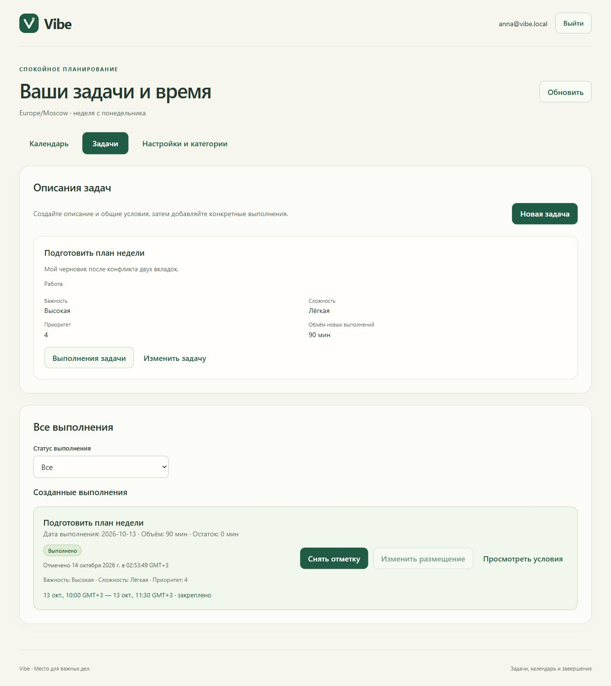

# Vibe — обратимая отметка выполнения C1

13.10.2026 владелец утвердил ревизию 2 C1 и поручил реализацию: «Утвердить C1 с отменой и реализовать». Основание и точные границы — [DECISIONS.md](DECISIONS.md), [COMPLETION_SLICE_PROPOSAL.md](COMPLETION_SLICE_PROPOSAL.md).

Обновлено 14.10.2026. Локальная реализация C1 завершена: проверки прошли, независимый reviewer завершил ревью без замечаний. После небольшого исправления подсказки фильтра выполнены окончательная сборка и узкое повторное ревью.

## Сценарий

У выбранного выполнения можно поставить отметку «Выполнено», снять её и поставить снова. Другие выполнения задачи сохраняют свой статус. Сервер хранит отдельные факты и историю отмен; отменённый факт не удаляется и не активируется повторно.

Календарный блок сохраняет дату, время, длительность, фиксацию и версию. Даже при остатке 0 блок остаётся занятым. Пока отметка действует, условия и размещение доступны только для чтения. Снятие отметки возвращает полный остаток текущего выполнения и возможность обычных D1 правок.

## Проверки

| Проверка | Фактический статус |
| --- | --- |
| Сохранность рабочей D1 перед добавлением схемы | Контрольные суммы строк девяти таблиц сохранены локально без публикации содержимого: 2 пользователя, 1 задача, 1 выполнение, 1 блок, 13 результатов операций |
| Общий OpenAPI C1 и примеры | PASS: полный openapi-spec-validator, 403 ссылки / 89 примеров у координатора; architect дополнительно проверил 90 schema/media примеров, 24 отклоняемых случая, неизменность auth и 20 входных схем D1 |
| Backend и PostgreSQL | 14.10.2026: Release build и 52/52 tests PASS, 0 failed/skipped. Отдельная vibe_d1_tests и проверяемые временные схемы; рабочая база не очищается. Проверены полный цикл, история/контекст, поздний target, no-op/replay/legacy, 7 сочетаний гонок, ownership/CSRF, фильтр до paging и cursor, UTC миллисекунды/коррекция часов, additive migration/partial unique/FK |
| Web tests / TypeScript / production build | 14.10.2026: TypeScript PASS, 42 tests passed (13 новых C1), Vite production build PASS. Первый sandbox check не запустил TypeScript из-за pnpm EPERM; успешные проверки выполнены координатором вне sandbox |
| Добавочная миграция и сохранность D1 | 20261013233411_AddCompletionHistory применена к рабочей локальной vibe. Up добавил только таблицу Completions, Source CHECK, ownership FK и partial unique active. SHA-256 строк всех девяти D1 таблиц до/после совпали: сохранены пользователи, данные, версии и 13 OperationResults; сразу после Up фактов 0. Down не применялся |
| Живой браузер и сохранность после перезапуска | PASS: mark A → снять A → mark B → reload → перезапуск API → reload; время B и вход сохранены. На обоих переходах блок 13.10 10:00–11:30/90 минут и закрепление сохранены. При active условия только для просмотра, размещение запрещено; после снятия форма снова редактируется. Все/incomplete/completed фильтры и остаток 0→90 проверены. B затем снят: демо возвращено к исходному незавершённому состоянию, история сохранена |
| Reviewer с техническим read-only / approval never | Официальный custom reviewer без истории через отдельный native CLI; родитель и reviewer до чтения подтвердили trusted read-only/never. Полное ревью и targeted recheck подсказки: findings P0–P3 нет. Сборки/тесты/БД/браузер reviewer не запускал; это фактические проверки координатора |
| Документация и исходники | Локальные Markdown-ссылки: 81, все существуют; git diff --check PASS с корректным учётом CRLF. Проверка 19 новых кандидатов файлов не нашла live passwords, GitHub tokens, private keys или исключённых private файлов; это проверка новых файлов, не новый push |

Первый серверный прогон дал 50/51 PASS: Identity при обновлении cookie добавлял no-cache к заголовку, нарушая literal контракт no-store. Ранний OnStarting API middleware теперь окончательно выставляет прежний no-store после framework callbacks. Auth/stamp renewal и rejection не отключались. Под общим управляемым временем реальные расшифрованные тестовые cookie подтверждают исходный 24-часовой deadline после 31 минуты и 23 часов, 401 после 25 часов и отклонение после изменения security stamp. Повторный полный прогон — 52/52 PASS.

Проверки runtime выполнялись вне Windows sandbox из-за ограничений доступа к pnpm, Docker и NuGet. Reviewer оставался в техническом read-only/never; отказ настройки консольного OutputEncoding не обходился, файлы прочитаны штатно. Worktree были созданы, но запись вне writable roots зависла на запросе доступа; неподтверждённые записи прерваны координатором. Код Backend/Web записан последовательно в основной разрешённой папке, один автор одновременно.

[После снятия отметки](images/vibe-c1-reopened.png): остаток снова 90 минут, блок сохранён, действия редактирования доступны.

Финальный read-only SQL после браузерного сценария подтвердил: settings/places/categories/definitions и все поля календарного блока совпадают с исходными SHA-256; все 13 старых OperationResults сохранились точно. В истории два разных факта, оба отменены, действующих нет. Новых задач/выполнений при проверке не создавали.

## Границы

Полная история хранится на сервере; отдельный экран истории в C1 не предусмотрен. Измеренное полезное время, таймер, статистика, цели, синхронизация, Android и автопланировщик остаются следующими этапами. Поддерживаемый Backend/Web обновляется согласованно; старые вкладки нужно перезагрузить. Сохранённые результаты D1 не переписываются, повтор старого запроса возвращает исходный ответ; Web после подтверждения читает актуальные данные.

15.10.2026 владелец отдельно поручил сохранить завершённый C1 в существующий публичный GitHub Sluchaino/Vibe — GH-02 в DECISIONS.md. Этот пакет подготовлен к коммиту и отправке после проверок; фактический идентификатор опубликованного коммита проверяется по истории Git/GitHub. Следующий пакет синхронизации согласовывается отдельно; production этим поручением не разрешён.
